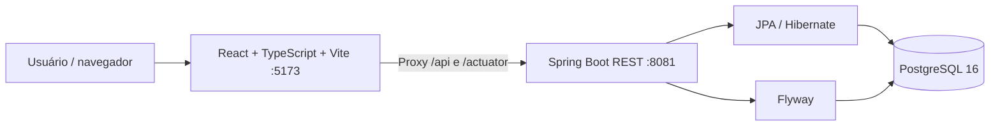
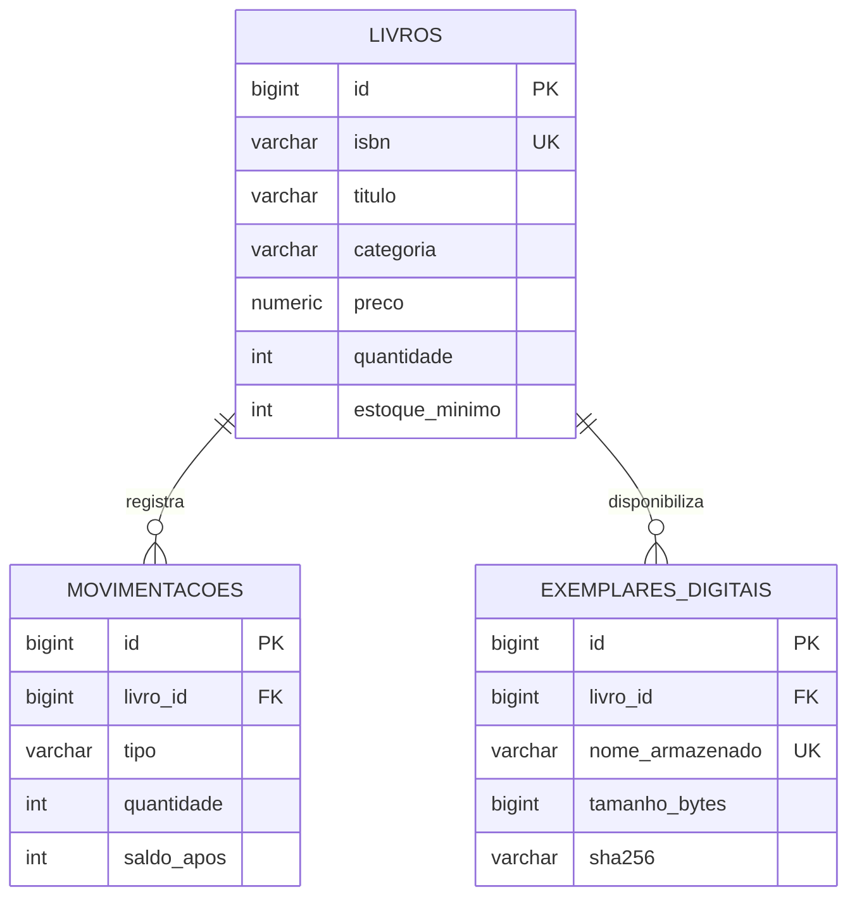

# 📚 LivroStock — Gestão de Acervo e Estoque

<p align="center">
  
  
  
  
  
  
  
</p>

**LivroStock** é um sistema full stack de controle de acervo e estoque de livros, desenvolvido como projeto de portfólio. Integra uma **API REST em Java 21 e Spring Boot**, uma **SPA em React e TypeScript** e um banco **PostgreSQL**, com persistência via JPA/Hibernate e migrações versionadas com Flyway.

> **Estado do projeto:** v0.1 validada em ambiente local, incluindo resposta da API, interface conectada e movimentação de estoque. Não é um sistema pronto para produção: autenticação, autorização, auditoria e gestão de segredos ainda precisam ser implementadas.

## ✨ Funcionalidades da v0.1

- Cadastro, consulta, edição e desativação lógica de livros
- ISBN, autor, categoria, preço e estoque mínimo
- Busca, paginação e visualização do catálogo
- Entrada e saída de estoque com histórico
- Validação de quantidade e impedimento de saldo negativo
- Indicadores de títulos, unidades, valor do acervo e estoque baixo
- Dashboard responsivo em React
- Documentação interativa Swagger / OpenAPI
- Versionamento do schema via Flyway
- Testes Java com JUnit e build do frontend em TypeScript

### Interface

O painel reúne **Visão geral**, **Catálogo de livros**, **Movimentações** e **Estoque baixo**. O status de conexão da API aparece no cabeçalho. Capturas de tela poderão ser incluídas em `docs/images/` após serem adicionadas ao repositório.

## 🧱 Arquitetura



| Camada | Tecnologias | Responsabilidade |
| --- | --- | --- |
| Frontend | React 18, TypeScript 5, Vite 6, Lucide | Interface, formulários, consumo da API |
| Backend | Java 21, Spring Boot 3.5.6, Spring Web, Bean Validation | Regras de negócio, endpoints REST |
| Persistência | Spring Data JPA, Hibernate, PostgreSQL 16 | Entidades, consultas e transações |
| Migrações | Flyway | Evolução controlada do banco |
| Documentação | springdoc / Swagger UI | Contrato e exploração da API |
| Qualidade | Maven, JUnit 5, GitHub Actions | Compilação, testes e integração contínua |

### Estrutura do repositório

```text
livrostock-fullstack/
├── backend/
│   ├── src/main/java/             # API e domínio
│   ├── src/main/resources/        # application.yml e Flyway
│   ├── src/test/                  # testes Java
│   ├── docker-compose.yml         # Compose de exemplo
│   └── pom.xml
├── frontend/
│   ├── src/                       # componentes, estilos e integração
│   ├── .env.example
│   ├── vite.config.ts
│   └── package.json
├── docs/
│   ├── API.md
│   ├── ARQUITETURA.md
│   └── ROADMAP.md
├── .github/workflows/ci.yml
└── README.md
```

## 🚀 Executando no Windows (PowerShell)

### Pré-requisitos

- JDK **21**
- Maven **3.9+**
- Node.js **20+** e npm
- PostgreSQL **16+**, local ou em Docker
- Docker Desktop, caso utilize PostgreSQL em contêiner

### 1. Clonar o projeto

```powershell
git clone https://github.com/juceliocoelho2022/livrostock-fullstack.git
cd livrostock-fullstack
```

### 2. Preparar o banco

A aplicação utiliza um banco chamado `livrostock`, normalmente com usuário `livrostock`. **Não use senhas reais no Git.** Configure o usuário e a senha no PostgreSQL antes de executar o backend.

**Atenção aos ambientes com múltiplos projetos Docker:** pode existir outro PostgreSQL instalado no Windows ou outro contêiner usando a porta `5432`. Na configuração local validada durante o desenvolvimento, o PostgreSQL Docker foi publicado em **`127.0.0.1:5434`**, mantendo a porta `5432` dentro do contêiner.

Para uma **nova instalação** com o Compose do próprio repositório, revise antes `backend/docker-compose.yml`: ele atualmente publica `5432:5432` e contém credenciais de exemplo. Ajuste as credenciais e a porta de publicação conforme seu ambiente, sem sobrescrever volumes de uma instalação existente.

Exemplo de publicação local alternativa no Compose:

```yaml
ports:
  - "127.0.0.1:5434:5432"
```

> Se já existe um banco funcional, **reutilize-o**. Não recrie contêineres/volumes desnecessariamente e nunca execute `docker compose down -v` sobre dados que deseja conservar.

### 3. Iniciar o backend

Abra um PowerShell na pasta do repositório:

```powershell
cd backend

$env:DB_URL = "jdbc:postgresql://127.0.0.1:5434/livrostock"
$env:DB_USER = "livrostock"
$senha = Read-Host "Senha do PostgreSQL" -AsSecureString
$env:DB_PASSWORD = [System.Net.NetworkCredential]::new("", $senha).Password

mvn clean test
mvn spring-boot:run
```

Se seu PostgreSQL estiver publicado em outra porta, altere apenas `DB_URL` (por exemplo, para `localhost:5432`).

A API é iniciada em **http://localhost:8081** por padrão; a porta pode ser alterada pela variável `PORT`.

### 4. Iniciar o frontend

Mantenha o backend em execução. Abra **outro terminal** na raiz do projeto:

```powershell
cd frontend
npm ci
Copy-Item .env.example .env
npm run dev
```

Acesse **http://localhost:5173**.

O Vite encaminha requisições iniciadas em `/api` e `/actuator` para `http://localhost:8081`. Para usar outro backend, ajuste `API_PROXY_TARGET` em `frontend/.env` e reinicie o Vite.

> `npm ci` requer o arquivo `package-lock.json` no repositório. Caso ele esteja ausente na sua cópia, utilize `npm install` e versione o lockfile.

### 5. Verificar a integração

No PowerShell:

```powershell
Invoke-RestMethod http://localhost:8081/actuator/health
Invoke-RestMethod http://localhost:8081/api/v1/livros
```

O primeiro endpoint deve retornar `status: UP`; o segundo deve retornar uma resposta paginada com `content`, `totalElements` e outros metadados.

Acesse a documentação: **http://localhost:8081/swagger-ui.html**.

## 🔌 Principais endpoints

| Método | Rota | Operação |
| --- | --- | --- |
| `POST` | `/api/v1/livros` | Cadastrar livro |
| `GET` | `/api/v1/livros` | Listar e pesquisar livros |
| `GET` | `/api/v1/livros/{id}` | Consultar livro por ID |
| `PUT` | `/api/v1/livros/{id}` | Atualizar dados |
| `DELETE` | `/api/v1/livros/{id}` | Desativar livro |
| `POST` | `/api/v1/livros/{id}/movimentacoes` | Registrar entrada ou saída |
| `GET` | `/api/v1/livros/{id}/movimentacoes` | Consultar histórico |
| `GET` | `/api/v1/livros/estoque-baixo` | Identificar necessidade de reposição |
| `GET` | `/actuator/health` | Verificar disponibilidade |

### Criar um livro

`POST /api/v1/livros`

```json
{
  "titulo": "Clean Code",
  "autor": "Robert C. Martin",
  "isbn": "9780132350884",
  "categoria": "Tecnologia",
  "preco": 99.90,
  "estoqueMinimo": 5
}
```

### Registrar entrada de 20 unidades

`POST /api/v1/livros/{id}/movimentacoes`

```json
{
  "tipo": "ENTRADA",
  "quantidade": 20,
  "observacao": "Reposição inicial do estoque"
}
```

### Registrar saída de 3 unidades

```json
{
  "tipo": "SAIDA",
  "quantidade": 3,
  "observacao": "Venda de exemplares"
}
```

**Resultado esperado:** após a entrada e a saída acima, um livro inicialmente sem estoque terá saldo final de **17 unidades**.

## 📖 Biblioteca digital — v0.2 (backend inicial, testes pendentes)

Um livro pode ter um ou mais **exemplares em PDF** associados ao seu cadastro, sem alterar a quantidade de exemplares físicos. A API recebe os documentos, mantém os metadados no PostgreSQL e grava o conteúdo em um diretório persistente, configurado por `PDF_STORAGE_DIR`.

**Endpoints adicionados à branch de desenvolvimento:**

| Método | Rota | Objetivo |
| --- | --- | --- |
| `POST` | `/api/v1/livros/{id}/exemplares-digitais` | Upload `multipart/form-data` com campo `arquivo` |
| `GET` | `/api/v1/livros/{id}/exemplares-digitais` | Listar PDFs relacionados ao livro |
| `GET` | `/api/v1/livros/{id}/exemplares-digitais/{exemplarId}/arquivo` | Abrir PDF no navegador |
| `GET` | `/api/v1/livros/{id}/exemplares-digitais/{exemplarId}/arquivo?download=true` | Solicitar download |

Validações iniciais: extensão `.pdf`, assinatura `%PDF-`, arquivo não vazio, limite de **20 MiB**, nome físico aleatório (UUID) e checksum SHA-256. O conteúdo **não** é salvo no banco.

> **Segurança:** os endpoints ainda não têm autenticação nem permissão por usuário. O cabeçalho PDF não substitui verificação antimalware; não exponha esse módulo publicamente. Somente envie exemplares de domínio público, com licença ou com autorização de uso/distribuição. A tela **Biblioteca Digital** no React já permite upload, consulta e visualização em um `iframe` que utiliza o leitor PDF nativo do navegador; PDF.js dedicado permanece planejado.

**Executar em desenvolvimento:** depois de atualizar sua branch, definir as variáveis de banco e `PDF_STORAGE_DIR` e aplicar as migrations, inicie o backend e acesse o Swagger. Veja um exemplo de envio em [docs/API.md](docs/API.md).

**Estado real:** migration, entidade, repositório, service e controller foram adicionados à branch da v0.2. **Compilação do backend e upload real de PDF foram validados localmente. A integração React foi codificada; teste manual da interface e hardening ainda pendentes.**

## 📏 Regras de negócio

1. O cadastro de um livro começa com saldo de estoque igual a zero.
2. Entradas aumentam e saídas reduzem a quantidade disponível.
3. A API impede saídas superiores ao saldo existente.
4. Cada movimentação preserva o tipo, a quantidade, o saldo após a operação e a data.
5. A desativação de livros é lógica, preservando o histórico.
6. Livros com saldo abaixo do mínimo configurado podem aparecer no alerta de reposição.

O inventário completo das regras e seus critérios de aceite está em **[docs/REGRAS_DE_NEGOCIO.md](docs/REGRAS_DE_NEGOCIO.md)**, com identificadores RN-001 a RN-007 e distinção entre **implementado** e **planejado**.

## 🗃️ DER — Diagrama Entidade-Relacionamento

O modelo físico atual mantém o estoque separado dos documentos digitais:



O **[DER completo, os atributos, os relacionamentos futuros e as decisões de arquitetura](docs/ARQUITETURA.md)** estão documentados separadamente.

## 🏢 Funcionalidades de um sistema profissional

| Funcionalidade | Prioridade | Situação |
| --- | --- | --- |
| Catálogo, ISBN, busca, movimentações e alertas | Alta | v0.1 funcional |
| Upload, metadados e leitura básica de PDF | Alta | Backend inicial v0.2, testes pendentes |
| Categorias, editoras e fornecedores normalizados | Alta | Planejado v0.2 |
| Leitor integrado via iframe/PDF nativo | Alta | Implementado no React, teste manual pendente |
| Leitor PDF.js dedicado | Média | Planejado |
| Gestão de licenças e direitos de acesso ao acervo digital | Crítica | Planejado |
| Login JWT, RBAC e auditoria de operações | Crítica | Planejado v0.3 |
| Testcontainers e testes ponta a ponta | Alta | Planejado |
| Movimentações com controle de concorrência | Alta | Planejado |
| Relatórios e exportação CSV/Excel | Média | Planejado |
| Backup de PostgreSQL + PDFs e restauração | Crítica | Planejado |
| S3/MinIO, checksum na leitura e antivírus de upload | Alta | Planejado |
| Observabilidade, tracing, métricas e alertas | Média | Planejado |
| CI/CD, HTTPS, deploy e documentação operacional | Alta | Planejado v1.0 |

## 🧪 Testes e qualidade

```powershell
# API: testes e empacotamento
cd backend
mvn clean verify

# SPA: verificação TypeScript e build de produção
cd ../frontend
npm ci
npm run build
```

Há um workflow de CI em `.github/workflows/ci.yml`, com jobs separados para Java e frontend. **Na execução da PR de 10/11/2026**, o pipeline compilou o React e executou **14 testes Java (11 de biblioteca digital e 3 do domínio Livro), sem falhas**. Consulte o resultado atualizado na aba **Actions**, pois versões posteriores podem mudar esse status.

Os testes locais de integração realizados na v0.1 confirmaram acesso ao endpoint de saúde, leitura do catálogo e operações de estoque na interface. Testes automatizados com banco real e Testcontainers são parte do roadmap.

## 🔒 Segurança e limitações

- A v0.1 **não possui login nem controle de acesso**. Não exponha esta API publicamente.
- As credenciais no Compose versionado são **exemplos de desenvolvimento** e deverão ser removidas antes de qualquer publicação.
- Mantenha segredos em variáveis de ambiente; não versione `.env` nem senhas reais.
- Para produção: implementar autenticação/autorização, gestão segura de credenciais, HTTPS, auditoria, observabilidade e políticas de backup.

## 🗺️ Roadmap

| Versão | Foco | Situação |
| --- | --- | --- |
| **v0.1** | Livros, movimentações, dashboard, Flyway e Swagger | Funcional localmente |
| **v0.2** | Exemplares PDF, categorias, editoras e fornecedores; testes de integração | Em desenvolvimento |
| **v0.3** | Spring Security, JWT, perfis de acesso, auditoria e observabilidade | Planejada |
| **v1.0** | Hardening, CI validado, deploy e documentação operacional | Planejada |

Consulte [roadmap](docs/ROADMAP.md), [regras de negócio](docs/REGRAS_DE_NEGOCIO.md), [arquitetura e DER](docs/ARQUITETURA.md) e [API REST](docs/API.md).

## 🔐 Segurança opcional da Biblioteca Digital (branch v0.3)

Um **perfil Spring `secure`** foi adicionado na branch `feature/v0.3-pdf-security`: login JWT válido por 30 minutos, perfis **BIBLIOTECARIO** (upload e leitura) e **LEITOR** (somente leitura/download). O React reconhece esse modo e usa tokens Bearer sem colocá-los na URL.

**O ambiente v0.2 local permanece inalterado quando o perfil seguro não está ativo.** A segurança ainda não está homologada para produção: outros endpoints permanecem públicos e faltam auditoria, rate limiting, inspeção antimalware e gestão de usuários.

Consulte o [manual de segurança e ativação no Windows](docs/SEGURANCA.md).

## 📄 Licença

Distribuído sob a licença **MIT**. Consulte [LICENSE](LICENSE).
