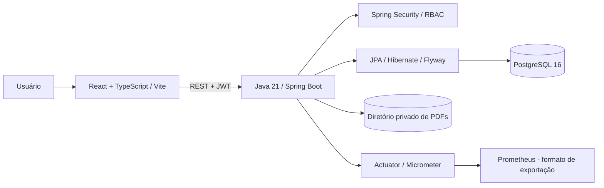

# 📚 LivroStock | Plataforma Full Stack de Gestão de Acervo

<p align="center">
  <strong>API REST segura, catálogo de livros, estoque e biblioteca digital com verificação de integridade.</strong>
</p>

<p align="center">
  
  
  
  
  
  
</p>

> **Status:** v0.9 homologada localmente em Windows (API, JWT e 9 PDFs digitais com SHA-256 `OK`). A **v1.0 está em desenvolvimento na branch `feature/v1.0-observabilidade-painel`**; não é um release de produção. O `main` mantém a base original e as versões seguintes estão em PRs encadeadas.

## Visão geral

O **LivroStock** é um projeto de engenharia de software para gestão de acervos físicos e digitais. O backend em **Java 21 e Spring Boot 3.5.6** expõe uma API REST; a interface em **React 18, TypeScript e Vite** oferece operações de catálogo, estoque, autenticação e leitura de PDFs. **PostgreSQL 16** armazena os metadados, enquanto os PDFs ficam em um diretório próprio persistente.

O projeto demonstra construção incremental, testes unitários e de integração, controle de acesso por perfil, versionamento SQL com **Flyway**, **backup/restauração verificável** e métricas operacionais com **Spring Boot Actuator e Micrometer**.

### Funcionalidades

| Área | Recursos | Estado |
| --- | --- | --- |
| Catálogo | Cadastro, consulta, edição, desativação lógica, busca e paginação | Implementado |
| Estoque | Entradas, saídas, histórico, bloqueio de saldo negativo e alertas | Implementado |
| Segurança | JWT (30 min), senhas BCrypt, perfis BIBLIOTECARIO/LEITOR e invalidação de tokens quando a conta muda | Implementado no perfil `secure` |
| Biblioteca digital | Upload de PDF, validação de assinatura e limite de 20 MiB, leitura e download autorizados | Implementado |
| Acervo digital | Pesquisa por título/autor, categoria e paginação sem consultas N+1 | v0.8 homologada |
| Integridade | SHA-256 e tamanho verificados na abertura; auditoria paginada para bibliotecários | v0.9 homologada |
| Backup | ZIP com dump PostgreSQL, PDFs e manifesto SHA-256; verificação e restauração em banco isolado | v0.6 homologada |
| Observabilidade | Actuator, Prometheus/Micrometer, contador de auditorias e painel administrativo React | **v1.0 em desenvolvimento** |

### Arquitetura



**Decisões de engenharia:** os arquivos binários não são gravados no PostgreSQL; o banco mantém metadados, tamanho e hash. O JWT fica em memória na SPA e não é enviado em URLs. A auditoria dos PDFs é sob demanda e paginada, sem alterar arquivos. No perfil `secure`, leitura e administração seguem permissões distintas.

## Stack

| Camada | Tecnologias |
| --- | --- |
| Backend | Java 21, Spring Boot 3.5.6, Spring Web, Spring Security, OAuth2 Resource Server |
| Persistência | Spring Data JPA, Hibernate, PostgreSQL 16, Flyway |
| Frontend | React 18, TypeScript 5, Vite 6, Lucide |
| Autenticação | JWT HS256, BCrypt, RBAC |
| Qualidade | JUnit 5, Mockito, MockMvc, Maven, GitHub Actions |
| Operação | Docker Compose, PowerShell, Spring Boot Actuator, Micrometer, Prometheus registry |
| API Docs | springdoc OpenAPI / Swagger UI |

## Executar localmente (Windows / PowerShell)

**Pré-requisitos:** JDK 21, Maven 3.9+, Node.js 20+, npm, Docker Desktop e PostgreSQL 16.

> Para testar a v1.0, use a branch correspondente. Não é necessário baixar novamente os PDFs nem recriar o banco já funcional.

```powershell
git clone https://github.com/juceliocoelho2022/livrostock-fullstack.git
cd livrostock-fullstack
git fetch origin
git switch --track origin/feature/v1.0-observabilidade-painel
```

Se a branch já existir localmente, use `git switch feature/v1.0-observabilidade-painel` e `git pull --ff-only`. **Preserve modificações locais no `application.yml`; não utilize `git reset --hard`.**

### 1. PostgreSQL

O ambiente Windows homologado usa o contêiner `livrostock-api-postgres-1` e publica a porta interna `5432` em **`127.0.0.1:5434`**:

```powershell
docker ps --filter "name=livrostock"
docker port livrostock-api-postgres-1 5432/tcp
```

O `backend/docker-compose.yml` versionado é apenas um **exemplo para novas instalações** e utiliza porta/credenciais de desenvolvimento. Não o aplique sobre volumes existentes sem revisar a configuração. **Nunca use `docker compose down -v` no acervo real.**

### 2. Backend

Em um **único terminal PowerShell**, configure as variáveis abaixo. Informe a senha real do PostgreSQL (não a senha de login do bibliotecário). Defina uma chave JWT de pelo menos 32 bytes; para desenvolvimento local pode ser gerada aleatoriamente, mas em operação persistente guarde-a em gerenciador seguro de segredos.

```powershell
cd backend

$env:SPRING_PROFILES_ACTIVE = "secure"
$env:PORT = "8081"
$env:DB_URL = "jdbc:postgresql://127.0.0.1:5434/livrostock"
$env:DB_USER = "livrostock"
$env:PDF_STORAGE_DIR = (Join-Path (Get-Location) "data/pdfs")

$senha = Read-Host "Senha do PostgreSQL" -AsSecureString
$env:DB_PASSWORD = [System.Net.NetworkCredential]::new("", $senha).Password
$env:SPRING_DATASOURCE_URL = $env:DB_URL
$env:SPRING_DATASOURCE_USERNAME = $env:DB_USER
$env:SPRING_DATASOURCE_PASSWORD = $env:DB_PASSWORD
Remove-Variable senha

# Apenas para desenvolvimento: esta chave muda a cada execução.
$bytes = New-Object byte[] 48
[System.Security.Cryptography.RandomNumberGenerator]::Fill($bytes)
$env:LIVROSTOCK_JWT_SECRET = [Convert]::ToBase64String($bytes)
Remove-Variable bytes

mvn clean test
mvn spring-boot:run
```

O comando de inicialização **precisa ser executado no mesmo terminal** que contém as variáveis. Observe no log `HikariPool-1 - Start completed`, validação das **5 migrations Flyway** e `Started LivroStockApplication`. O perfil `default` não habilita o conjunto completo de segurança: **não o exponha publicamente**.

### 3. Frontend

Em outro terminal:

```powershell
cd frontend
npm ci
npm run dev
```

Abra **http://localhost:5173**. O Vite encaminha `/api` e `/actuator` para `http://localhost:8081`. Faça login com uma conta `bibliotecario` ou `leitor` existente no PostgreSQL (não com o usuário da máquina Windows).

### 4. Verificação rápida

```powershell
Invoke-RestMethod http://localhost:8081/actuator/health
Invoke-RestMethod http://localhost:8081/api/v1/auth/mode
```

Resultado esperado: `UP` e `enabled=True, strategy=jwt`.

## API e permissões

| Método | Endpoint | Permissão em `secure` |
| --- | --- | --- |
| `POST` | `/api/v1/auth/login` | Público (credenciais válidas) |
| `GET` | `/api/v1/auth/mode` | Público |
| `GET` | `/api/v1/livros` | BIBLIOTECARIO / LEITOR |
| `POST, PUT, DELETE` | `/api/v1/livros` e `/api/v1/livros/{id}` | BIBLIOTECARIO |
| `POST` | `/api/v1/livros/{id}/movimentacoes` | BIBLIOTECARIO |
| `GET` | `/api/v1/acervo-digital?busca=Spring&page=0&size=10` | BIBLIOTECARIO / LEITOR |
| `GET` | `/api/v1/acervo-digital/integridade?page=0&size=10` | BIBLIOTECARIO |
| `GET` | `/api/v1/livros/{id}/exemplares-digitais/{exemplarId}/arquivo` | BIBLIOTECARIO / LEITOR |
| `POST` | `/api/v1/livros/{id}/exemplares-digitais` | BIBLIOTECARIO |
| `GET` | `/api/v1/usuarios`, `/api/v1/auditoria` | BIBLIOTECARIO |
| `GET` | `/actuator/health`, `/actuator/info` | Público |
| `GET` | `/actuator/metrics`, `/actuator/prometheus` | **BIBLIOTECARIO** (v1.0) |

O acesso a métricas e à auditoria da integridade exige token Bearer. No `secure`, solicitações sem token devem retornar `401` e o perfil LEITOR deve receber `403` nas rotas administrativas.

### Integridade dos PDFs

A v0.9 calcula o hash novamente ao abrir um arquivo e bloqueia sua entrega quando o conteúdo ou tamanho diferem do registro original. A auditoria administrativa retorna:

- `OK`: tamanho e hash SHA-256 conferem;
- `AUSENTE`: arquivo não localizado;
- `DIVERGENTE`: tamanho ou SHA-256 incompatível;
- `ERRO_LEITURA`: erro de acesso ou leitura do arquivo.

**Homologação real em 11/11/2026:** 9 documentos digitais verificados, **9 `OK`, 0 problemas**. O diretório local de backup continha 10 PDFs; a auditoria lista apenas exemplares associados a livros exclusivamente digitais e ativos. O décimo arquivo pode estar associado a um livro de estoque ou fora desse filtro — não foi identificado como erro.

### Observabilidade v1.0

A v1.0 adiciona a exportação **Prometheus** para métricas do Micrometer e o contador `livrostock_pdf_integridade_verificacoes_total{estado="OK|AUSENTE|DIVERGENTE|ERRO_LEITURA"}`. O painel de integridade no React aparece somente para **BIBLIOTECARIO** autenticado e mostra o resultado da página solicitada, sem ler todo o acervo automaticamente.

Exemplo de consulta ao endpoint protegido depois de autenticar:

```powershell
$headers = @{ Authorization = "Bearer <token-JWT-valido>" }
Invoke-RestMethod "http://localhost:8081/actuator/metrics" -Headers $headers
Invoke-WebRequest "http://localhost:8081/actuator/prometheus" -Headers $headers
```

Não copie o JWT para o README, scripts versionados, tickets ou capturas públicas. As métricas foram configuradas para uso **local autenticado**; a instalação de um servidor Prometheus, dashboard Grafana, alertas e deploy externo não fazem parte desta entrega.

## Backups e restauração

A operação segura exige copiar **PostgreSQL + diretório físico de PDFs**. Antes do backup consistente, pare o processo Spring Boot, mas mantenha o contêiner PostgreSQL ativo:

```powershell
cd C:\Projetos\livrostock-repo
.\ops\criar-backup.ps1 -Destino "C:\Backups\LivroStock" -DiretorioPdf "C:\Projetos\livrostock-repo\backend\data\pdfs" -ContainerPostgres "livrostock-api-postgres-1" -ConfirmoAplicacaoParada
```

Verifique o ZIP gerado com `ops/verificar-backup.ps1`. O restore de teste utiliza `ops/restaurar-em-teste.ps1` e um **banco separado**, nunca o banco principal. Os backups incluem dados privados e **não são criptografados automaticamente**: armazene-os fora do Git, em mídia protegida.

**Backup real em 11/11/2026:** ZIP íntegro com **10 PDFs**, dump PostgreSQL e manifesto SHA-256 verificado.

Consulte [manual de backup v0.6](docs/V0_6_BACKUP_RESTAURACAO.md) e [integridade v0.9](docs/V0_9_INTEGRIDADE_PDFS.md).

### Homologação automatizada da v1.0 no Windows

Com o backend iniciado no perfil `secure` na porta `8081`, rode **na raiz do projeto**, em outro PowerShell:

```powershell
.\ops\homologar-v1.0.ps1
```

O script pergunta a senha da conta `bibliotecario` sem exibi-la e verifica `health`, login JWT, integridade de todas as páginas do acervo, métricas Micrometer e exportação Prometheus. **É somente leitura**: não altera PDFs ou registros PostgreSQL. O sucesso real deve ser validado localmente, nunca inferido de um CI remoto.

## Qualidade e CI/CD

```powershell
cd backend
mvn clean test
cd ../frontend
npm ci
npm run build
```

O workflow [GitHub Actions](.github/workflows/ci.yml) inclui cinco jobs: testes Java 21, integração Flyway/JWT/PostgreSQL 16, build TypeScript, verificação de backup PowerShell e restauração Docker isolada. Os testes de integração de banco requerem `LIVROSTOCK_INTEGRATION_DB=true` e **não devem ser executados diretamente contra o banco com PDFs reais**. O CI utiliza dados sintéticos e contêiner descartável.

## Evolução do produto

| Versão | Entrega | Estado |
| --- | --- | --- |
| v0.1 | API de livros, estoque, dashboard, Flyway | Base funcional |
| v0.2–v0.4 | PDFs, JWT, controle de acesso e auditoria | Branches de evolução |
| v0.5 | Usuários PostgreSQL, BCrypt, revogação de tokens | Implementado |
| v0.6 | Backup e restauração verificados | Homologado localmente |
| v0.7 | Importação privada de PDFs do Drive | Homologado localmente |
| v0.8 | Busca paginada e filtro do acervo digital | Homologado localmente |
| **v0.9** | Integridade SHA-256 dos PDFs | **Homologado: 9/9 OK** |
| **v1.0** | Micrometer/Prometheus e painel de integridade | **Em desenvolvimento / PR** |

As evoluções são organizadas em **PRs encadeadas**; não devem ser confundidas com releases já integrados à `main`.

## Segurança, escopo e limitações

- Use o perfil `secure` com HTTPS, segredos gerenciados, rede restrita e políticas de backup para qualquer ambiente externo. O projeto **não está homologado para produção pública**.
- PDF com cabeçalho válido e SHA-256 íntegro **não significa que passou por antivírus**, que possui licença de distribuição ou que seu armazenamento é imutável.
- O projeto não publica PDFs pessoais, arquivos de backup, credenciais nem bases reais de dados no repositório.
- Todo o uso de documentos digitais deve respeitar licenças e direitos autorais; conteúdos privados não são automaticamente redistribuíveis.
- Itens futuros: testes de carga, limitação de requisições, armazenamento versionado, monitoramento/alertas externos, HTTPS e hardening de implantação.

### Documentação adicional

- [API REST](docs/API.md)
- [Arquitetura e DER](docs/ARQUITETURA.md)
- [Regras de negócio](docs/REGRAS_DE_NEGOCIO.md)
- [Segurança](docs/SEGURANCA.md)
- [Importação de PDFs do Drive](docs/V0_7_IMPORTACAO_DRIVE.md)
- [Acervo paginado](docs/V0_8_ACERVO_API.md)
- [Auditoria de integridade](docs/V0_9_INTEGRIDADE_PDFS.md)

## Licença

Licenciado sob [MIT](LICENSE). Projeto de portfólio e estudo de engenharia de software.
