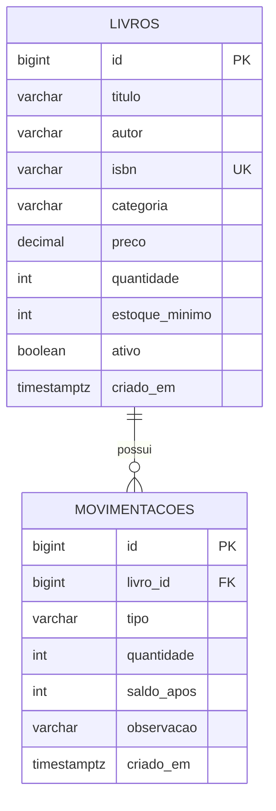

# LivroStock API 📚

API REST de cadastro de livros e controle de estoque. Projeto de estudo/portfólio com **Java 21, Spring Boot 3.5.6, PostgreSQL 16, Flyway, JPA, Jakarta Validation e Swagger/OpenAPI**.

## Recursos (v0.1)

- Cadastrar, consultar, atualizar e desativar livros (exclusão lógica)
- ISBN único; quantidade inicia em zero
- Entrada e saída de estoque com registro de histórico e saldo final
- Bloqueio pessimista em movimentações para prevenir saídas concorrentes além do estoque disponível
- Consulta paginada, busca por título/autor/ISBN e relatório de estoque baixo
- Validação de campos, erros HTTP e migração SQL versionada

## Iniciar no IntelliJ IDEA

**Requisitos:** JDK 21, Maven 3.9+ ou Maven integrado do IntelliJ, Docker Desktop com Compose.

1. Na pasta do projeto: `docker compose up -d`
2. Abra o `pom.xml` no IntelliJ como projeto Maven e configure o SDK Java 21.
3. Execute `LivroStockApplication` ou `mvn spring-boot:run`.
4. Abra Swagger: http://localhost:8080/swagger-ui.html e health: http://localhost:8080/actuator/health

A aplicação roda localmente; o Docker Compose sobe somente o PostgreSQL. Se a porta `5432` estiver ocupada, mude o mapeamento para `5434:5432` e inicie o app com `DB_URL=jdbc:postgresql://localhost:5434/livrostock`.

## Endpoints

| Método | Caminho | Descrição |
|---|---|---|
| POST | `/api/v1/livros` | Cadastrar |
| GET | `/api/v1/livros?busca=java&page=0&size=20` | Listar/pesquisar |
| GET | `/api/v1/livros/{id}` | Consultar |
| PUT | `/api/v1/livros/{id}` | Atualizar dados (ISBN imutável) |
| DELETE | `/api/v1/livros/{id}` | Desativar |
| POST | `/api/v1/livros/{id}/movimentacoes` | Entrada ou saída |
| GET | `/api/v1/livros/{id}/movimentacoes` | Histórico |
| GET | `/api/v1/livros/estoque-baixo` | Itens no mínimo ou abaixo |

### Exemplo: cadastrar

```bash
curl -X POST http://localhost:8080/api/v1/livros \
 -H 'Content-Type: application/json' \
 -d '{"titulo":"Clean Code","autor":"Robert C. Martin","isbn":"9780132350884","categoria":"Tecnologia","preco":99.90,"estoqueMinimo":3}'
```

### Exemplo: dar entrada de 10 unidades no livro 1

```bash
curl -X POST http://localhost:8080/api/v1/livros/1/movimentacoes \
 -H 'Content-Type: application/json' \
 -d '{"tipo":"ENTRADA","quantidade":10,"observacao":"Compra de fornecedor"}'
```

Para saída, use `"tipo":"SAIDA"`. Saídas acima do saldo retornam `400`.

## Regras de negócio

1. ISBN identifica o livro e não pode mudar depois do cadastro; livros desativados preservam o ISBN.
2. Estoque inicial é zero. Quantidade só se altera por movimentação auditável.
3. Não é permitido estoque negativo, movimentação com quantidade zero, preço negativo ou estoque mínimo negativo.
4. Entrada e saída atualizam saldo e inserem histórico na mesma transação.
5. Uma movimentação bloqueia a linha do livro até confirmar a transação, evitando perda de atualização concorrente.
6. Desativação é lógica e impede novas movimentações; histórico permanece.
7. Estoque baixo significa `quantidade <= estoqueMinimo`, inclusive quantidade zero.

## Modelo de dados (DER)



## Testes

`mvn test` (testes unitários do domínio; próximo passo: integração com Testcontainers).

## Próximas versões

- v0.2: autores, editoras, categorias normalizadas, fornecedores e compras
- v0.3: usuários, JWT/RBAC, auditoria de usuário, idempotência e relatórios
- v0.4: vendas, clientes, pedidos, código de barras e dashboard

**Importante:** v0.1 é um MVP local de aprendizado, sem autenticação ou autorização. Não exponha publicamente até implementar segurança, gestão de segredos e testes de integração.
