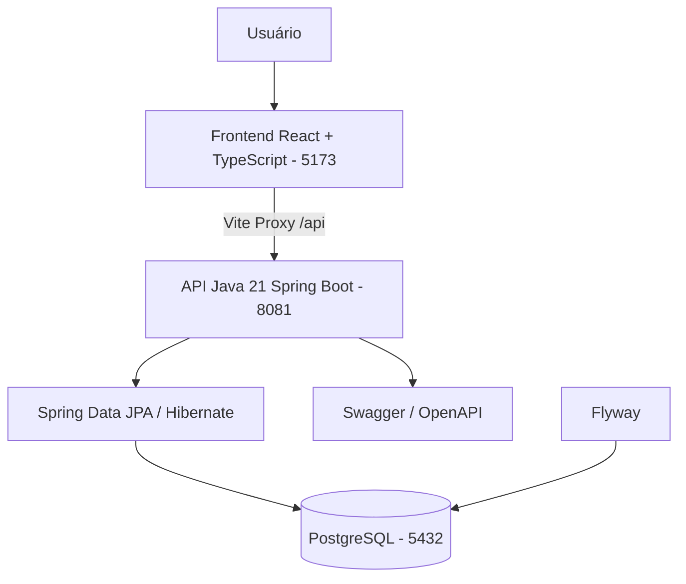
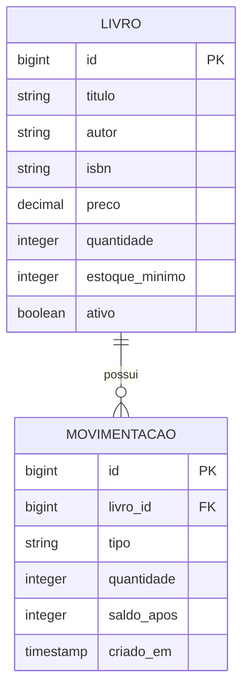

# Arquitetura

## Visão geral

## Decisões

- Monorepo: facilita revisão e entrega do frontend e backend juntos.
- Backend concentra validação de estoque e persistência; frontend apenas consome a API.
- O saldo é alterado exclusivamente por movimentações. Não permitir que o formulário de edição altere o saldo diretamente.
- Migrações SQL via Flyway e `ddl-auto: validate`.
- Proxy de desenvolvimento evita depender de CORS para `localhost:5173`.
- Para produção, usar proxy reverso, autenticação, HTTPS e banco gerenciado.

## Modelo de domínio

