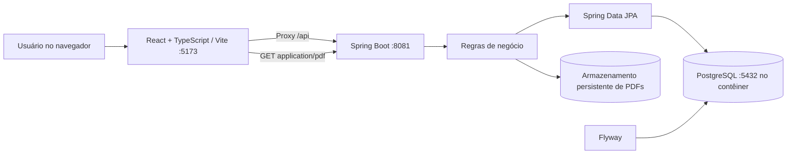
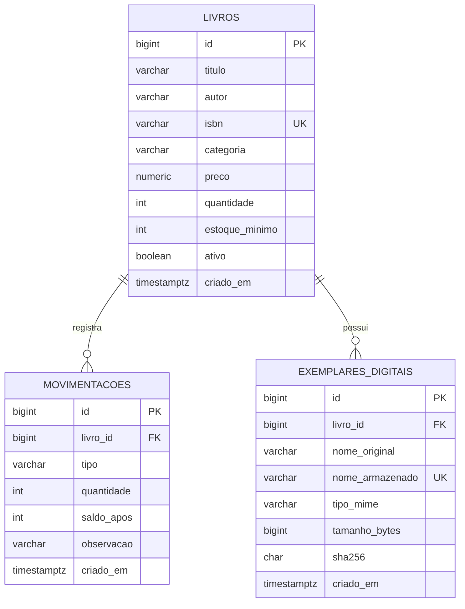
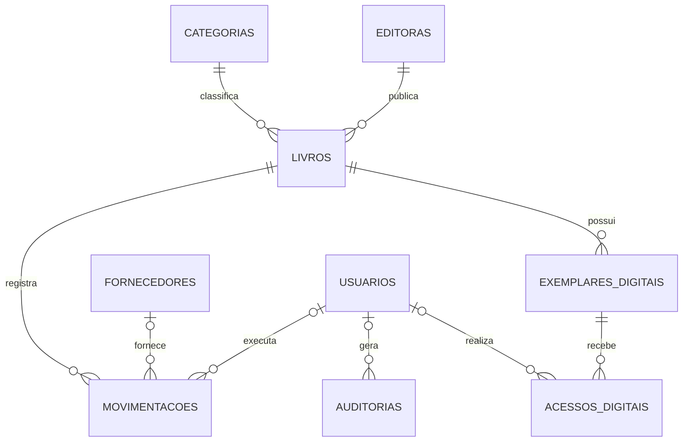

# Arquitetura e DER — LivroStock

## Arquitetura lógica

Em desenvolvimento, a publicação PostgreSQL usada para evitar conflito de portas no Windows foi `127.0.0.1:5434:5432`. Os arquivos digitais são armazenados fora do banco; o PostgreSQL mantém metadados e associação ao livro.

## DER — modelo físico existente (v0.1 + backend inicial v0.2)

> A tabela `EXEMPLARES_DIGITAIS` é introduzida pela migration `V2__create_exemplares_digitais.sql` na branch da v0.2. O DER não representa categorias/editoras/fornecedores como tabelas existentes: ainda são planejadas. A categoria de `LIVROS` é textual nesta etapa.

## DER conceitual — direção de evolução

**Importante:** todo o segundo diagrama é uma proposta arquitetural. Nenhuma dessas novas tabelas deve ser criada sem migration e testes de compatibilidade.

## Decisões de engenharia

1. **Separação de responsabilidades:** frontend não calcula nem altera saldo de estoque diretamente; regras vivem na API.
2. **Evolução do banco:** Flyway cria estruturas incrementalmente; JPA com `ddl-auto: validate`.
3. **Armazenamento de arquivos:** filesystem configurável em dev; em produção, adotar armazenamento privado como S3/MinIO, com credenciais e acesso restritos.
4. **Segurança dos PDFs:** a v0.2 inicial valida tamanho, extensão e cabeçalho; isso **não é** inspeção antimalware nem autenticação. A API não deve ser exposta em rede pública.
5. **Consistência:** transações de banco e filesystem não são atômicas. Implementar fluxo de gravação temporária, confirmação transacional e limpeza periódica de órfãos.
6. **Auditoria e LGPD:** registrar ações e proteger dados pessoais quando usuários e permissões forem implementados.
7. **Concorrência:** futuras regras transacionais para impedir corrida entre saídas simultâneas.
8. **Observabilidade:** health, logs estruturados, métricas, rastreamento e alertas no roadmap.
9. **Deploy:** proxy reverso, HTTPS, segredos externos ao código e backups consistentes do banco + storage.

Veja [regras de negócio](REGRAS_DE_NEGOCIO.md) e [API](API.md).
